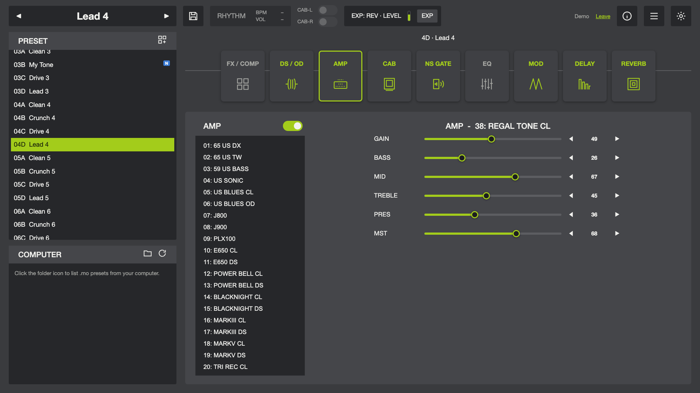
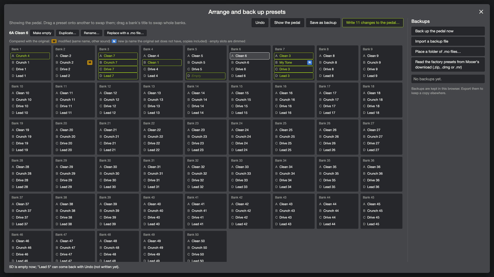
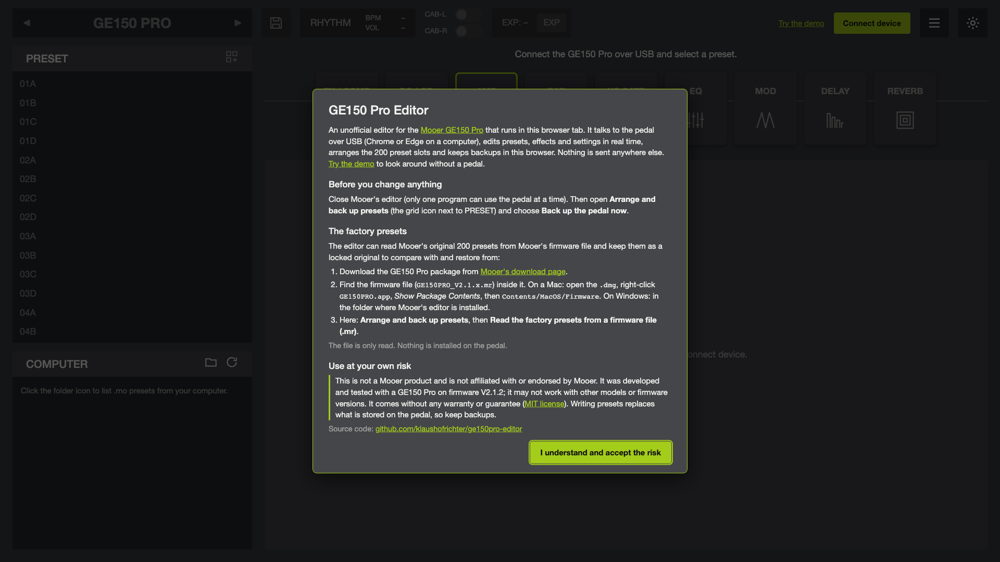

# GE150 Pro Editor

[](https://github.com/klaushofrichter/ge150pro-editor/releases)
[](https://github.com/klaushofrichter/ge150pro-editor/actions/workflows/pr-checks.yml)
[](https://github.com/klaushofrichter/ge150pro-editor/actions/workflows/deploy-pages.yml)
[](https://github.com/klaushofrichter/ge150pro-editor/security/dependabot)

<!-- No version numbers in this text: the release badge carries the version. -->

An editor for the **Mooer GE150 Pro** guitar multi-effects pedal that runs in the browser. Connect the pedal by USB,
open the page in Chrome or Edge, and edit presets, effects and settings in real time, arrange the 200 preset slots,
and keep backups. Nothing to install, and nothing leaves your computer.

**Open it: <https://klaushofrichter.github.io/ge150pro-editor/>** — or [try the demo](https://klaushofrichter.github.io/ge150pro-editor/?demo)
without a pedal (made-up presets).

Unofficial: not affiliated with or endorsed by Mooer. Product and model names are those of their owners and are used
only to describe what the pedal does.



## What it does

| Area | |
|---|---|
| Presets | All 200 presets (banks 1–50, A–D): select, rename, store, step through them; unsaved changes are marked |
| Effects | The nine modules (FX/COMP, DS/OD, AMP, CAB, NS GATE, EQ, MOD, DELAY, REVERB): on/off, model and every parameter, in real time and in both directions (turn a knob on the pedal and the slider follows) |
| Expression pedal | Module and parameter it controls, EXP VOL switch and range, the controlled value live |
| System | Input and USB levels, display brightness, cab simulation on the outputs, global EQ, spill-over, display language |
| Drum machine | Shows play state, mode, style, BPM and volume (the pedal does not accept drum machine control over USB) |
| Files | Import and export `.mo` presets, compatible with Mooer's editor; browse a folder of `.mo` files |
| Arrange and back up | See below |

### Arrange and back up



- **Arrange** the 200 slots on one screen: drag a preset onto another to swap them, drag a bank's title to swap whole
  banks. Click a slot to **make it empty**, **duplicate** the preset into another slot under a new name (or
  Option-drag it), **rename** it, or **replace it with a `.mo` file**, for example one downloaded from elsewhere (pick
  it, or drop it from the Finder onto the slot). Every change is pending, highlighted and can be undone.
- **Write** the changed slots to the pedal: after a warning, the editor saves a backup of the pedal, writes each slot
  (about a third of a second per preset, a progress bar shows where it is, and it can stop between presets), then
  reads every preset back and compares.
- **Backups** are kept in the browser. Export one as a single file, or as a folder of `.mo` files named `01A Name.mo`
  … `50D Name.mo` with a `manifest.json` that describes the set (name, kind, dates, where it came from, a checksum per
  file). Importing a folder places it by its manifest and reports any file that has changed since.
- **The original:** read the factory presets from Mooer's firmware file (`.mr`, firmware V2.1.2 or V2.1.4), and they
  become a locked backup that cannot be changed or deleted. Presets are then marked **M** (modified: a factory name
  with another sound) or **N** (new: a name the factory set does not have, copies and renamed presets included).

The firmware file comes with Mooer's editor or from Mooer's download page; this repository contains no firmware and
nothing taken from it. To keep the factory presets as files, run

```sh
node scripts/extract-factory.mjs GE150PRO_V2.1.2.mr factory-presets
```

which writes the 200 presets as `.mo` files with a manifest (kind `original`, immutable) into a new folder and makes it
read-only.

## Requirements

- Google Chrome or Microsoft Edge on a computer (Windows, macOS, Linux): the page talks to the pedal over
  [WebHID](https://developer.mozilla.org/docs/Web/API/WebHID_API). Safari and Firefox do not support it.
- The pedal connected by USB, and Mooer's editor closed: only one program can use the pedal at a time.
- Tested with firmware V2.1.2.

## Good to know

- On the first visit a panel explains what the editor is, how to get the factory presets in, and that you use it at
  your own risk; it stays away once confirmed (remembered in the browser) and can be read again from the tools panel
  (**About and factory presets**).

  

- The first **Connect device** asks Chrome for permission to use the pedal; the page connects by itself afterwards.
- Changes to effects are live on the pedal but not stored until you save the preset (the disk icon). Arrangements are
  written only with **Write … to the pedal**, which always asks first.
- The editor sends only commands observed between Mooer's editor and the pedal; it never sends a factory reset or a
  firmware update. The protocol is described in [docs/protocol.md](docs/protocol.md).
- Backups live in your browser, for this page's address. Export them to keep a copy elsewhere or to move them to
  another browser.

## Development

```sh
npm ci
npm run dev           # http://localhost:5173 (add ?demo for the demo)
npm test              # unit tests
npm run check         # type check
npm run e2e           # browser tests on the built app (demo mode)
npm run screenshots   # renders docs/screenshots/
```

Node 26 (`.nvmrc`). Type checking uses TypeScript 7 (`@typescript/native`, through `svelte-check --tsgo`); TypeScript 6
is installed as `typescript` because svelte-check still needs it. Branches: work on a feature branch, open a pull request to `main`; a release is a pull request
from `main` to `production`. `production` is protected (the `test`, `e2e` and `codeql` checks must pass), and every
push to it publishes the app on GitHub Pages with a calendar version (`YYYY.MM.DD.N`, shown in the tools panel and as
a GitHub release).

## License

[MIT](LICENSE)
